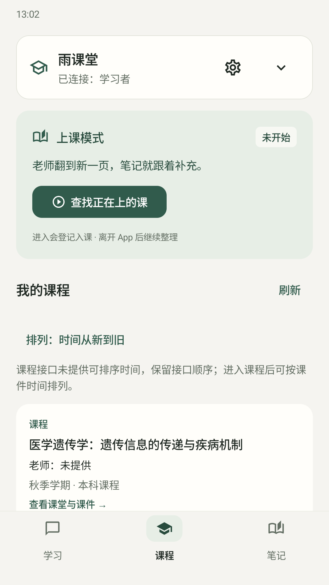
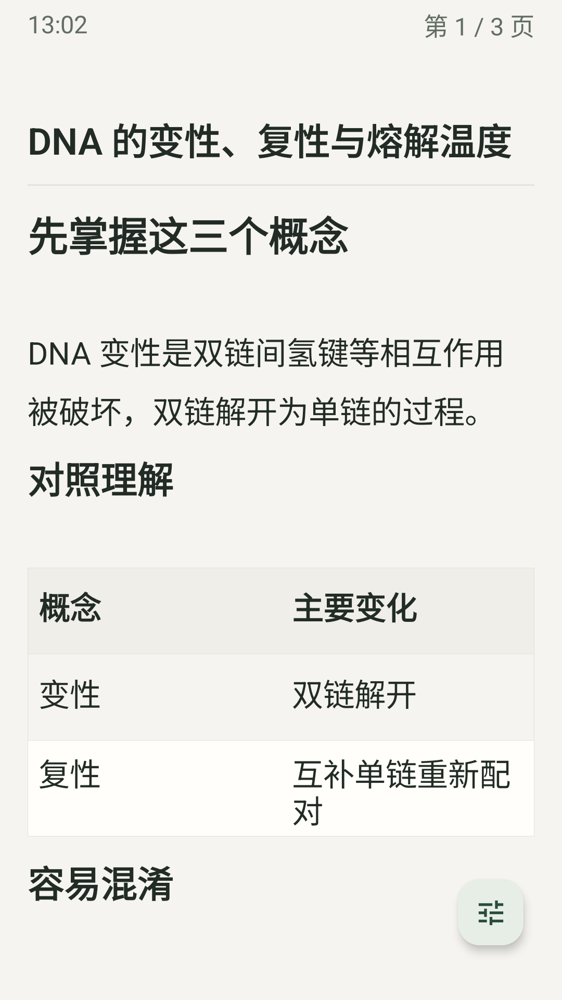
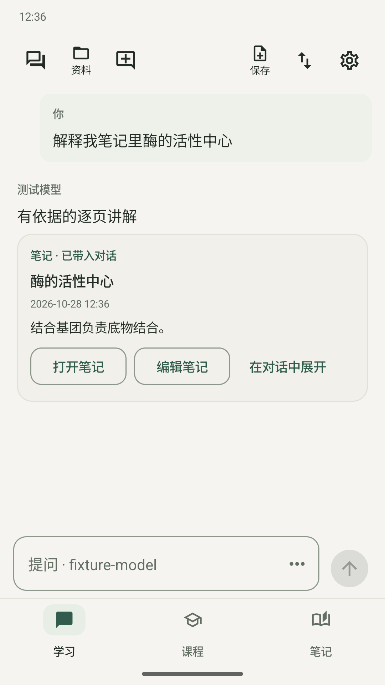

# 雨课伴学 · 雨课堂 AI 实时课堂笔记

**连接雨课堂，开启上课模式，让 AI 随课件整理重点笔记。**

雨课伴学是一款开源 Android 学习助手：上课时逐页整理课件，课后继续阅读、批注和提问。支持雨课堂、荷塘雨课堂、长江雨课堂与黄河雨课堂，实际可读内容取决于学校和账号权限。

Open-source Android AI study assistant for Yuketang (Rain Classroom): slide-based class notes, course Q&A and note-taking.

**[下载 Android 1.0.7 APK](https://github.com/ahdaolma/yuketang-mcp/releases/download/v1.0.7/rain-study-1.0.7.apk)** · [查看版本与更新](https://github.com/ahdaolma/yuketang-mcp/releases) · [详细使用说明](android/README.md)

Android 8.0 及以上 · MIT 开源 · 使用自己的模型账号或 API

## 界面预览

  
  
  

课程与上课模式 · 笔记阅读 · 笔记问答。图片为 1.0.7 云端合成课程示例，点击可查看原图；[截图来源](docs/images/README.md)。

## 开始使用

1. **安装并连接模型**：下载 APK 安装，在「设置 → 模型与账号」选择账号授权，或填写可用的模型接口。也可在学习偏好中填写自己的基础、难点和目标。
2. **连接雨课堂**：在「课程」中选择对应的雨课堂版本，微信扫码确认后核对账号，读取已开放的课程与课件。
3. **开始整理**：查找正在上的课并进入，上课模式会随已展示课件页补充同一份笔记；也可选择已有课件直接讲解或生成笔记。笔记在「笔记」中阅读、编辑和导出。

## 可以用它做什么

| 场景 | 功能 |
| --- | --- |
| 上课跟随 | 按已展示的课件页整理笔记，支持暂停、继续和后台跟课；授权悬浮窗后可在其他应用上控制 |
| 课后整理 | 按课程 / 章节分类，多选原笔记生成独立知识总览，保留原文、修改和个人备注 |
| 理解知识 | 带入课件或已保存笔记提问；课程范围问答每轮读取最新保存内容，来源段落可点开核对 |
| 阅读与批注 | 连续阅读、点击或横向翻页，两种纸面动画，字号调整、查找高亮、选词标记和图片批注 |
| 保留学习资料 | 草稿、历史、回收站、标签与关联；支持 Markdown / PDF 导出和包含原图、批注的笔记备份 |

在「设置 → 笔记生成」打开**超重点模式**，后续生成会更简短，保留核心结论、条件和易错点。

## 使用条件与资料范围

- **模型服务**：需连接自己的可用账号或 API；费用、额度和可用模型以所用服务为准。[配置方式](android/README.md#课件笔记与模型)
- **资料来源**：上课笔记依据可读取的课件页整理，应用不录音。AI 补充、个人备注与课件原文需要区分；学校接口变化或课件权限不足时，可用内容会受影响。
- **本机数据**：Android 的笔记、聊天和登录记录加密保存在本机；带入模型请求的图片和文字会发送给你配置的服务。重要资料可先导出备份。

## 版本与验证

当前正式版为 **1.0.7**。更新说明、安装包及校验文件见[发布页](https://github.com/ahdaolma/yuketang-mcp/releases/tag/v1.0.7)。

查看云端验证范围与历史记录

1.0.7 完成 211 项单元、212 项完整云端设备操作及 Android 8 的 19 项专项，均无失败或跳过；固定签名 R8 包及公开 1.0.6 覆盖升级保留笔记和加密偏好通过。设备验收使用云端模拟器与合成资料，真实学校账号、课堂、模型语义质量和厂商实机的边界单独记录。

- [1.0.7 完整验证记录](docs/releases/1.0.7-verification.md)
- [历次版本与验证材料](docs/releases/)
- [0.8 系列历史说明](docs/releases/android-0.8-history.md)

## 开发与 MCP 接入

仓库包含 Android 客户端，以及供支持 MCP 的助手读取授权课程和课件的 Python / 私有云端服务。按需选择入口：

- [Android 源码、使用说明与构建](android/README.md)
- [Python / 私有云端 MCP 接入与 Windows 启动](docs/mcp-usage.md)
- [云端实现与部署限制](cloud/README.md)
- [问题反馈](https://github.com/ahdaolma/yuketang-mcp/issues)

## 开源许可与声明

本项目为独立学习辅助工具，与雨课堂官方无隶属关系。原创代码采用 [MIT 许可证](LICENSE)，允许商用及闭源修改，须保留版权和许可；第三方依赖遵循各自许可证。请仅使用有权访问的学习资料，核对 AI 内容并备份重要数据；软件按现状提供，责任限制见许可证和 App 内项目声明。
